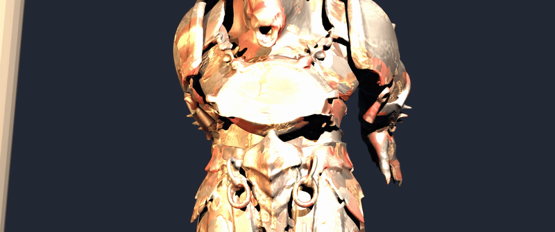

# Kaliyuga: The Bleeding Crown (कलयुग)
> **AAA Mythic Action Roguelike & Cinematic 3D Production Suite**



## ⚔️ Project Overview

**Kaliyuga: The Bleeding Crown** is an isometric 3D mythic action roguelike inspired by *Hades* and *classic mythological action games*, infused with ancient Indian mythology (Kurukshetra, Kalaripayattu, Deva Boons, and the Asura Warlords). 

The repository contains:
1. **The Complete Playable Game**: Full Next.js 15 + React 19 + TypeScript + Three.js application with a custom 3D isometric combat engine (`rudra3dRenderer.ts`, `boss3dRenderer.ts`), procedural chambers, boon drafting systems, and dynamic audio.
2. **Cutscene Suite**: Master Blender 5.2 EEVEE Next 3D production files, procedural bone keyframing pipelines, and high-fidelity 1080p CinemaScope cutscene exports.
3. **Full 3D & 2D Asset Vault**: High-poly rigged characters, 4K PBR textures (Albedo, Normal, Roughness, Metallic), combat animation libraries, weapons, and concept turnaround sheets.

---

## 🏛️ Repository Architecture

```
kaliyuga/
├── app/                           # Next.js 15 App Router (layout, page, global styling)
├── components/                    # UI & Gameplay React Components
│   ├── game/
│   │   ├── KaliyugaArena.tsx        # Main 3D Canvas Arena & Combat Loop
│   │   ├── TitleScreen.tsx        # Mythic Title & Mode Selection
│   │   ├── BoonModal.tsx          # Deva Boon Upgrade Interface
│   │   ├── StoryCodexModal.tsx    # Lore Codex & Bestiary
│   │   ├── KeepersShrineModal.tsx # Persistent Altar Upgrades
│   │   └── OutcomeModal.tsx       # Run Victory / Defeat Breakdown
│   └── audit/                     # Technical Sandbox & Performance Audits
├── lib/                           # Core Game Logic & 3D Renderers
│   └── game/
│       ├── rudra3dRenderer.ts     # Three.js 3D Player Character Rig & Shaders
│       ├── boss3dRenderer.ts      # Three.js 3D Boss (Dundubhi / Vrikodara) Engine
│       ├── rules.ts               # Damage formulas, hitboxes, collision detection
│       ├── boons.ts               # Deva Boons, elemental synergies, status effects
│       ├── audio.ts               # Web Audio API spatial sound synthesis
│       └── assets.ts              # Unified asset registry and chamber specifications
├── public/                        # Game Runtime Assets
│   ├── models/                    # Runtime 3D FBX Character Rigs & Weapons
│   └── assets/aistudio/           # Sprites, environmental backdrops, decals, VFX
├── cutscenes/                     # 3D Cutscene Production Studio
│   ├── kaliyuga_god_of_war_boss_intro.mp4 # Master 1080p CinemaScope Cutscene
│   ├── kaliyuga_god_of_war_boss_intro.gif # Animated High-Res Preview
│   ├── kaliyuga_god_of_war_master.blend   # Blender 5.2 Master 3D Scene
│   ├── scripts/                   # Procedural Python Animation & Camera Pipelines
│   └── assets/                    # Cutscene 3D Models, PBR Maps & Animation Packs
├── package.json                   # Project Dependencies & Scripts
├── tsconfig.json                  # Strict TypeScript Configuration
└── next.config.ts                 # Next.js Build & Asset Configurations
```

---

## 🎬 Cinematic Boss Entry Cutscene

The cutscene showcases **Dundubhi (The Bronze-Horned Asura Warlord)** in the **Iron Sanctuary**:

* **Aspect Ratio**: 2.39:1 Anamorphic CinemaScope ($1920 \times 804$).
* **Directorial Style**: *God of War* single-shot continuous take with physical 42mm anamorphic lens, shallow Depth of Field ($f/2.8$), and ground-impact screen vibration.
* **Lighting**: Dual blazing temple braziers ($16{,}000\text{W}$), warm amber key light ($22{,}000\text{W}$), and an electric cyan rim light ($48{,}000\text{W}$) carving the warlord's horns out of the dark basalt sanctuary.
* **Audio**: 42 Hz sub-bass seismic tremor, tension riser, bronze impact shockwave, and guttural beast roar.

---

## 🚀 Getting Started

### Prerequisites
* **Node.js**: v18.0.0 or later (Node 20+ recommended)
* **npm** or **bun**

### Installation & Launch

```bash
# Clone the repository
git clone https://github.com/akshat92008/kaliyuga.git
cd kaliyuga

# Install dependencies
npm install

# Run the local development server
npm run dev
```

Open [http://localhost:3000](http://localhost:3000) in your browser to enter Kurukshetra.

### Production Build

```bash
npm run build
npm start
```

---

## 📜 License
Private & Proprietary — Developed for Kaliyuga: The Bleeding Crown. All rights reserved.
